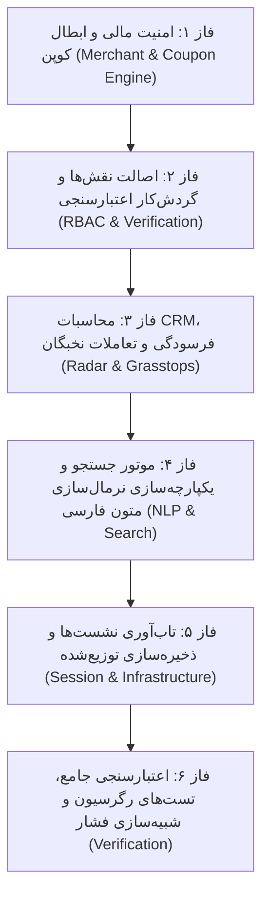

# برنامه جامع اصلاحات گام‌به‌گام و مرحله‌بندی شده معماری سیستم
## پلتفرم شبکه نخبگان و باشگاه وفاداری توسعه شهری (Civic & Loyalty Network)

این سند نقشه راه اجرایی، گام‌به‌گام و مرحله‌بندی شده جهت رفع ۷ باگ منطقی، آسیب‌پذیری‌های امنیتی، ریس کاندیشن‌ها و نقص‌های محاسباتی شناسایی‌شده در سیستم است.

---

## 📌 خلاصه فازبندی عملیات اصلاح



---

## فاز ۱: تصحیح منطق مالی، ایزوله‌سازی پذیرندگان و جلوگیری از دابل اسپندینگ

### ۱.۱. ایزوله‌سازی اعتبارسنجی پین پذیرنده بر اساس شناسه کسب‌وکار (Cross-Merchant Isolation)
* **فایل‌های درگیر:**
  - `src/app/api/discounts/verify-pin/route.ts`
  - `src/app/verify-coupon/page.tsx`
* **اقدامات اجرایی:**
  1. به‌روزرسانی فرم و رابط کاربری `/verify-coupon` تا علاوه بر کد کوپن و پین ۴ رقمی، پذیرنده بتواند فروشگاه خود را انتخاب کند یا از طریق آدرس اختصاصی پذیرنده (`/verify-coupon?businessId=...`) وارد شود.
  2. در کنترلر API، ورودی `businessId` اجباری شود.
  3. کوئری دیتابیس مستقیماً با بررسی انطباق `businessId` و `merchantPin` انجام گیرد تا حتی در صورت برابری پین دو مغازه مختلف، امکان مصرف اشتباه یا تعمدی کوپن سایر فروشگاه‌ها وجود نداشته باشد.

### ۱.۲. رفع آسیب‌پذیری مسابقه (Race Condition) و جلوگیری از دابل اسپندینگ کوپن‌ها
* **فایل‌های درگیر:**
  - `src/app/api/discounts/verify-pin/route.ts`
* **اقدامات اجرایی:**
  1. حذف فرآیند دو مرحله‌ای `findUnique` و سپس `update`.
  2. پیاده‌سازی به‌روزرسانی شرطی اتمیک (Atomic Conditional Update) در پایگاه‌داده:
     ```typescript
     const result = await prisma.redemption.updateMany({
       where: {
         verificationCode: code,
         status: 'ACTIVE',
         expiresAt: { gt: new Date() },
         offer: {
           businessId: businessId,
           business: { merchantPin: enteredPin }
         }
       },
       data: {
         status: 'REDEEMED',
         redeemedAt: new Date()
       }
     });
     if (result.count === 0) {
       return NextResponse.json({ error: 'کد نامعتبر است، منقضی شده یا قبلاً مصرف گردیده است' }, { status: 400 });
     }
     ```

### ۱.۳. مهار انباشت کدهای معلق (Redemption Flooding) و اعتبارسنجی انقضای آفر
* **فایل‌های درگیر:**
  - `src/app/api/discounts/redeem/route.ts`
* **اقدامات اجرایی:**
  1. پیش از صدور کوپن، بررسی فعال بودن کسب‌وکار (`business.isActive`) و تاریخ انقضای آفر (`offer.expiresAt > now`).
  2. بررسی وجود کوپن فعال برای همین کاربر و همین آفر. در صورت وجود، همان کد قبلی تحویل داده شود تا از صدور بی‌رویه کدهای تصادفی و پر شدن فضای کدهای ۶ رقمی جلوگیری گردد.

---

## فاز ۲: تثبیت سطوح دسترسی (RBAC) و ایمن‌سازی گردش‌کار اعتبارسنجی

### ۲.۱. جلوگیری از تنزل ناخواسته نقش مدیران و رابطین معتمد (Role Demotion on Approval)
* **فایل‌های درگیر:**
  - `src/app/api/verification/admin-verify/route.ts`
  - `src/app/api/verification/connector-vouch/route.ts`
* **اقدامات اجرایی:**
  1. اصلاح دستور تایید پروفایل سازمانی:
     - کاربر با نقش `MEMBER_PUBLIC` به `MEMBER_VIP` ارتقا یابد.
     - کاربران با نقش‌های اداری نظیر `CONNECTOR`، `ADMIN_VERIFIER`، `ADMIN_CLUB` یا `REPRESENTATIVE_VIP` نقش اصلی‌شان حفظ شده و فقط `tier = 'VIP'` برایشان ثبت شود.

### ۲.۲. پیاده‌سازی منطق هوشمند تنزل سطح (Downgrade Engine) در زمان رد یا تعلیق
* **فایل‌های درگیر:**
  - `src/app/api/verification/admin-verify/route.ts`
* **اقدامات اجرایی:**
  1. اگر ادمین استعلام یک ادعای سازمانی را `REJECTED` کرد، سیستم باید چک کند آیا کاربر پروفایل `VERIFIED` دیگری دارد یا خیر.
  2. در صورت عدم وجود هیچ پروفایل تایید شده دیگر، `tier: 'PUBLIC'` شده و اگر کاربر `MEMBER_VIP` بوده، به `MEMBER_PUBLIC` بازگردانده شود.

### ۲.۳. انسداد کامل امکان تایید خود (Self-Vouching Protection)
* **فایل‌های درگیر:**
  - `src/app/api/verification/upgrade-request/route.ts`
  - `src/app/api/verification/connector-vouch/route.ts`
* **اقدامات اجرایی:**
  1. جلوگیری از انتخاب شماره تلفن یا کد معرف خود کاربر در فرم ارتقای VIP.
  2. در متد اعتبارسنجی معرف، اعتبارسنجی اجباری اعمال شود: `if (connector.id === session.userId) throw Forbidden`.

---

## فاز ۳: بازطراحی موتور محاسباتی CRM و رادار نماینده (Rep Radar & Grasstops)

### ۳.۱. اصلاح اسکوپ و افق محاسبات شاخص فرسودگی (Burnout Scoping & Windowing)
* **فایل‌های درگیر:**
  - `src/app/api/radar/search/route.ts`
  - `src/lib/utils.ts`
* **اقدامات اجرایی:**
  1. حذف شرط `take: 10` از تعاملات؛ استعلام تمام تعاملات ۳۰ روز گذشته کاربر از جدول `InteractionLog` با شرط `createdAt >= now - 30 days`.
  2. تجمیع تعاملات در سطح `User` نه صرفاً `OrganizationalProfile`. اگر فردی دارای ۳ جایگاه سازمانی است، مجموع تعاملات برقرار شده با این فرد باید تعیین‌کننده نشانگر فرسودگی (خطر تماس مکرر) برای تمامی کارت‌های او باشد.

### ۳.۲. تصحیح منطق موازنه بده‌بستان (Reciprocity Balance on Unsuccessful Outcomes)
* **فایل‌های درگیر:**
  - `src/app/api/radar/interactions/route.ts`
* **اقدامات اجرایی:**
  1. تراز `favorBalance` پروفایل سازمانی تنها در صورت `outcome === 'SUCCESSFUL'` تغییر یابد:
     - برای پیگیری‌های به نتیجه رسیده (`FAVOR_REQUESTED` و `SUCCESSFUL`): کسر ۱ امتیاز (بدهکار شدن نماینده).
     - برای جبران‌های به نتیجه رسیده (`FAVOR_RETURNED` و `SUCCESSFUL`): افزایش ۱ امتیاز (تسویه یا طلبکار شدن).
     - در صورت `UNSUCCESSFUL` یا `PENDING`: تراز بده‌بستان بدون تغییر بماند و فقط گزارش تعامل ثبت شود.

---

## فاز ۴: یکپارچه‌سازی نرمال‌سازی متون فارسی و جستجوی دیتابیس

### ۴.۱. هماهنگ‌سازی نرمال‌سازی حروف الفبا با داده‌های پایگاه‌داده
* **فایل‌های درگیر:**
  - `src/lib/persian.ts`
  - `src/app/api/radar/search/route.ts`
  - `src/app/api/organizations/route.ts`
* **اقدامات اجرایی:**
  1. بازنگری در تبدیل `[آأإ]` به `ا`؛ جلوگیری از شکست کوئری‌های فیلترسازمانی نظیر «آموزش و پرورش».
  2. تفکیک متد نرمال‌سازی عمومی نام‌ها و متد نرمال‌سازی جستجو.
  3. استفاده از فیلترهای دوگانه یا ساخت ستون متنی نرمال‌شده برای مقایسه‌های امن و سریع.

---

## فاز ۵: تاب‌آوری نشست‌ها و معماری ذخیره‌سازی توزیع‌شده

### ۵.۱. ساخت لایه انتزاعی ذخیره‌ساز موقت OTP و Rate-Limit
* **فایل‌های درگیر:**
  - `src/lib/auth.ts`
  - `src/lib/rate-limit.ts`
* **اقدامات اجرایی:**
  1. ایجاد مکانیسم پاک‌سازی خودکار و بازه‌های زمانی (Periodic TTL Cleanup) برای `Map`های درون‌حافظه‌ای جهت جلوگیری از نشت رم (Memory Leak).
  2. آماده‌سازی قرارداد واسط (Storage Adapter Interface) برای اتصال آسان به Redis/KeyDB در محیط‌های ابری چندکانتینره.

### ۵.۲. به‌روزرسانی فعال توکن‌ها و اعتبارسنجی وضعیت فعال کاربر
* **فایل‌های درگیر:**
  - `src/lib/auth.ts`
  - `middleware.ts`
* **اقدامات اجرایی:**
  1. افزودن مکانیزم کنترل سریع نشست برای عملیات‌های با حساسیت بالا (Admin & Radar) بدون کاهش کارایی سرور.

---

## فاز ۶: سناریوهای آزمون جامع، تست نفوذ و اعتبارسنجی نهایی

### ۶.۱. آزمون‌های خودکار یکپارچه (Integration Tests)
* پیاده‌سازی اسکریپت آزمون پوشش‌دهنده سناریوهای زیر در `test/audit-fixes.test.ts`:
  1. آزمون ورود همزمان دو صندوق‌دار برای ابطال یک کوپن تخفیف (شبیه‌سازی Race Condition) و اطمینان از اینکه دقیقاً یک درخواست موفق و دیگری ناموفق می‌شود.
  2. آزمون تلاش برای مصرف کوپن فروشگاه الف در فروشگاه ب با پین یکسان و اطمینان از مسدود شدن آن.
  3. آزمون حفظ نقش `CONNECTOR` پس از تایید مدرک دانشگاهی‌اش توسط ادمین و تایید تغییر `tier` به `VIP`.
  4. آزمون شاخص فرسودگی کاربر دارای ۲ پروفایل با ۴ تماس متناوب در ۲۰ روز اخیر و اطمینان از نمایش هشدار فرسودگی در هر دو پروفایل.
  5. آزمون تراز بده‌بستان در تماس‌های ناموفق و اطمینان از عدم تغییر تراز.
